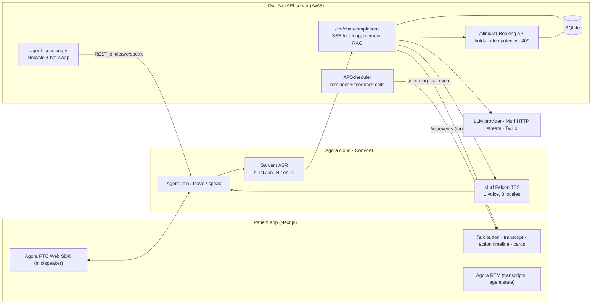

# ArogyaVaani · आरोग्य वाणी · ಆರೋಗ್ಯ ವಾಣಿ

**Health in your language.** A voice-first agent that turns a 2-minute conversation in Hinglish, Hindi or Kannada into a *booked, confirmed and followed-up* doctor visit. No app to learn, no forms, no English required.

> Built for **Build with Agora, Bengaluru (21 Nov 2026)** · Track 5 *Voice AI for Bharat* · **PS11 Multilingual Healthcare Assistant**
> Stack: **Agora Conversational AI** (ConvoAI REST, RTC, RTM, custom LLM) · **Murf Falcon** TTS · **Sarvam** ASR · FastAPI · Next.js · AWS

| | |
| --- | --- |
| Demo video (2 min) | `<DEMO_VIDEO_URL>` |
| Live demo | `<DEPLOYED_URL>` (add `?demo=1` for demo controls) · nurse console at `/console/` |
| Judge's 60-second path | [docs/demo-script.md](docs/demo-script.md) |

> All doctors, clinics and bookings are **fictional demo data**. ArogyaVaani gives guidance only and **never diagnoses**. In an emergency call **108**.

## The problem

Most people in India don't book doctors on apps. They call someone who speaks their language, and too often there's nobody to call. Lakshmi, 62, in Jayanagar speaks Kannada and Hindi, mixes in English words like "appointment" and "BP", and can't read English. Her son lives in Pune. PS11 asks: can she get an appointment *done* just by talking, and be looked after afterwards? A bot that only chats in Hindi doesn't answer that. One that **completes and follows up** does.

## The journey: Before, During, Action, After

| Stage | What happens | Tools | Edge cases handled |
| --- | --- | --- | --- |
| **Before** | One big talk button. The agent greets by name in the saved language, or asks 3 short questions for a new user. | `get_patient_profile`, `save_patient_profile` | New user: no forms, voice only |
| **During** | Code-mixed symptoms (*"ghutne mein dard hai, chalne mein problem"*) are triaged to a specialty, never diagnosed. Red flags are checked first. Top 3 doctors are ranked by **spoken-language match**, distance, fee, PM-JAY. | `triage_symptoms`, `search_doctors` (ranked directory search), `search_knowledge` (BM25 RAG over prep / PM-JAY / policy FAQs), `geocode_area` | Red flag: stop booking, say "call 108", alert the nurse |
| **Action** | Check slots, **hold the slot for 120 s**, read back the details, book only after a spoken "haan". | `check_availability`, `hold_slot`, `confirm_booking` (idempotency key), `cancel_booking` | Slot taken (409): offer the next two. Timeout: one retry, then promise a callback. Changed mind: release the hold |
| **Confirm** | Spoken confirmation in the user's language. WhatsApp/SMS to patient **and caregiver** with a **Murf voice note** and an `.ics` invite. | `send_confirmation`, `generate_voice_note`, `schedule_followup` | Twilio fails: in-app inbox keeps the same message |
| **After** | The agent **calls the patient**: an in-app ring, then the agent speaks first with the reminder and prep. After the visit it asks for a 1-5 voice rating and offers the follow-up. | scheduler, `record_feedback`, booking tools again | Declined or unanswered calls are not retried yet (roadmap) |

### Moments built for judges

1. **Language hot-swap mid-call.** *"Kannada dalli maathadi"* restarts the agent with Kannada ASR and the **same Murf Falcon voice** in `kn-IN`; it greets with a recap of the booking from memory.
2. **Transaction-grade booking.** Holds with TTL, idempotency keys, a live "slot just taken" recovery.
3. **Red-flag safety + human takeover.** Chest pain triggers 108 guidance and a console alert; a nurse types and **the agent speaks the nurse's words** (Agora `speak`).
4. **Proactive "After" call.** The agent starts the conversation itself.
5. **Murf used twice.** Falcon streams live through Agora, and Murf's HTTP stream API renders the voice-note.

## Architecture



Every user turn: browser → Agora (Sarvam ASR) → **our `/llm` endpoint**, which runs tools against the booking API and streams only spoken text → Agora (Murf Falcon) → browser. `agent_session.py` is the only module that calls Agora's REST API.

## Agora Conversational AI integration

- **Start** via ConvoAI REST `join` (through the official `agora-agents` SDK): Sarvam ASR, our OpenAI-compatible **custom LLM endpoint**, Murf Falcon TTS, `enable_rtm: true`, `data_channel: rtm`, metrics on, interruption via `turn_detection.start_of_speech` (VAD), `idle_timeout: 120`.
- **Custom LLM, not the built-in one**, because we need a stateful multi-round tool loop, RAG, memory and a server-side safety gate. The endpoint validates Agora's Bearer key and streams OpenAI-style SSE; Agora never sees a `tool_call`. Before any tool runs, a short **spoken filler** is streamed so the user never hears silence.
- **`speak`** (≤ 512 bytes, `INTERRUPT`/`APPEND`/`IGNORE`) powers the nurse takeover.
- **Hot-swap.** The update API documents only `token` and `llm` fields, so ASR/TTS can't change on a live agent. A language switch is therefore `leave`, then `join` with the new Sarvam language and Murf locale, in the same RTC channel. Memory survives because it lives in our DB keyed by session/patient. The measured swap time is shown in the UI timeline.
- **RTC** carries audio, **RTM** carries live transcripts and agent state, our own **WebSocket `/ws/events`** carries tool events to the timeline.

The exact `properties` sent to `join` (generated by `agent_session.build_join_payload`, secrets redacted) is in [docs/join-payload.json](docs/join-payload.json):

```jsonc
{
  "asr": { "vendor": "sarvam", "params": { "api_key": "<redacted>", "language": "hi-IN" } },
  "tts": { "vendor": "murf", "params": { "base_url": "wss://in.api.murf.ai/v1/speech/stream-input",
           "voiceId": "<multi-locale-voice>", "locale": "hi-IN", "model": "FALCON", "rate": 0, "pitch": 0, "sample_rate": 24000 } },
  "llm": { "url": "https://<host>/llm/chat/completions", "style": "openai", "vendor": "custom",
           "system_messages": [{ "role": "system", "content": "session=<id>;lang=hi-IN;patient=<id>" }], "max_history": 32 },
  "advanced_features": { "enable_rtm": true, "enable_tools": false },
  "parameters": { "data_channel": "rtm", "enable_metrics": true, "enable_error_message": true }
}
```

`enable_tools` is `false` because tools run *inside* our LLM endpoint.

## Murf Falcon integration

- `vendor: murf`, `model: FALCON`, India WebSocket endpoint, **one multi-native voice for hi-IN, kn-IN and en-IN** so the persona never changes when the language does (pick it with `server/scripts/murf_voices.py`, which lists voices supporting all three locales).
- Uses `locale` (`multiNativeLocale` is deprecated). **Elder mode** lowers `rate` by 10 and restarts the agent to apply it.
- Script per locale: Devanagari for Hindi with English medical words left in Latin script (Falcon code-mixes them), Kannada script for Kannada.
- **Second integration:** Murf's HTTP stream API (`POST /v1/speech/stream`, MP3) generates a ~20 s **voice-note** of each booking for low-literacy users, with a `pronunciationDictionary` for terms like PM-JAY, ECG, MRI. Cached by text hash.

## Agentic workflow

16 typed tools (JSON Schema) in [`server/src/tools/`](server/src/tools): `get_patient_profile`, `save_patient_profile`, `triage_symptoms`, `geocode_area`, `search_doctors`, `search_knowledge`, `check_availability`, `hold_slot`, `confirm_booking`, `cancel_booking`, `send_confirmation`, `generate_voice_note`, `schedule_followup`, `record_feedback`, `set_language`, `escalate_to_human`. Each call emits `tool_start`/`tool_end` events with latency to the live **Agent actions** timeline.

Example trace with the demo "force conflict" toggle on (illustrative, not measured):

```
triage_symptoms("ghutne mein dard…")          -> orthopaedics, routine
search_doctors(orthopaedics, Jayanagar)       -> Dr. Suresh Rao (kn,hi) …
check_availability(doc01, tomorrow)           -> 8 slots
hold_slot(doc01, 10:00)                       -> 409 CONFLICT, alternatives [10:30, 11:00]
hold_slot(doc01, 10:30)                       -> hold_id, ttl 120 s
(patient says "haan")
confirm_booking(hold_id)                      -> BK…  (idempotency key = hash(session, hold))
send_confirmation(BK…)                        -> inbox/WhatsApp to patient + caregiver, voice note, .ics
schedule_followup(BK…)                        -> reminder T-12h, feedback T+2h
```

**Reliability.** Every outbound call: 8 s timeout, one retry, structured log `{tool, ms, ok}`. A tool crash never kills the turn. Up to 6 tool rounds per turn; the last round offers no tools so the model must answer. Replies are cut to 2 sentences server-side. LLM failover via `LLM_FALLBACK_*`; ASR vendor switch via `ASR_VENDOR=ares`.

## Safety and limitations

- **No diagnosis, no prescriptions.** The agent only routes to a specialty and books.
- **Red flags are deterministic and run before the LLM**: chest pain, stroke signs, breathing difficulty, heavy bleeding, suicidal talk, fainting, pregnancy bleeding, infant fever, in Roman and native script for Hindi, Kannada and English. A hit stops booking, speaks the 108 guidance, and alerts the nurse console. While an escalation is open the endpoint replies with a holding line only.
- **Fictional data.** Doctors, clinics, fees and PM-JAY flags are invented for the demo.
- The red-flag keyword list is a safety net, not a clinical tool. It will miss phrasings it does not know.
- Outbound **PSTN calls are not implemented** (the "call" is an in-app ring) and unanswered calls are not retried or sent as SMS yet. PSTN needs an Agora SIP trunk; see Roadmap.
- The Docker image and the live Agora/Murf/Sarvam pipeline are configured per the vendor docs and covered by unit tests with fakes; they need real keys for a first live run.
- The console password is a shared secret; the token endpoints are public. Add auth and rate limits before real use.

## Evaluation

[eval/results.md](eval/results.md): 30 scripted code-mixed utterances (10 each Hinglish/Hindi, Kanglish/Kannada, English). The deterministic router scores 21/21 on specialty routing and 9/9 on red-flag recall. This is a small developer-written smoke test, not a benchmark; two labels were corrected after the first run (documented in the file). A second table with a real LLM is generated when `LLM_API_KEY` is set.

Backend: **104 pytest tests** (clinic API holds/idempotency/expiry, red flags in 3 languages, ranking, SSE contract, tool loop, hot-swap, speak limits, scheduling, server wiring). Web: `bun run verify` (API contract + production build).

## Run it locally

```bash
git clone <this repo> && cd arogyavaani
bun run setup                              # web deps + Python venv
cp server/.env.example server/.env.local   # fill Agora, LLM, Sarvam, Murf keys
python server/scripts/murf_voices.py       # pick a voice that supports hi-IN, kn-IN, en-IN -> MURF_VOICE_ID
ngrok http 8000                            # set CUSTOM_LLM_URL and PUBLIC_BASE_URL to the https URL
bun run dev                                # backend :8000 + web :3000 -> open http://localhost:3000/?demo=1
```

Tests: `bun run test` (or `make test`). Demo data reset: `curl -X POST localhost:8000/demo/reset`.

## Deploy on AWS

One `t3.small` EC2 instance, Docker, Caddy for automatic HTTPS on a free `sslip.io` hostname: [docs/deploy-aws.md](docs/deploy-aws.md). The `Dockerfile` builds the web app as a static export and serves it from FastAPI (single container).

## Roadmap

- Outbound **PSTN reminder calls** through Agora's telephony API (`/call`, SIP trunk) for feature-phone users
- ABDM / ABHA integration, real clinic-system adapters behind the same `/clinic/v1` contract
- More languages (Tamil, Telugu, Malayalam: the doctor directory already lists them)
- Prescription capture by camera, Razorpay payment links, the tool registry exposed over MCP
- EventBridge Scheduler and Amazon Bedrock as drop-in AWS replacements for APScheduler and the LLM provider

**Who pays:** clinic chains and state health programs pay per booked visit; the same agent re-skins to labs, pharmacies and insurance claims. Every call is ConvoAI minutes.

## Credits

Thanks to **Agora**, **Murf.ai**, **AWS**, **KNOTiC / Commudle**, **Polaris** and **Packt**. Started from Agora's open-source [recipe-agent-tool-calling](https://github.com/AgoraIO-Conversational-AI/recipe-agent-tool-calling) (MIT). Docs used: [Agora ConvoAI](https://docs.agora.io/en/conversational-ai/overview), [Murf Falcon](https://murf.ai/api/docs), [Sarvam ASR](https://docs.agora.io/en/ai/models/asr/sarvam).

[MIT License](LICENSE)
